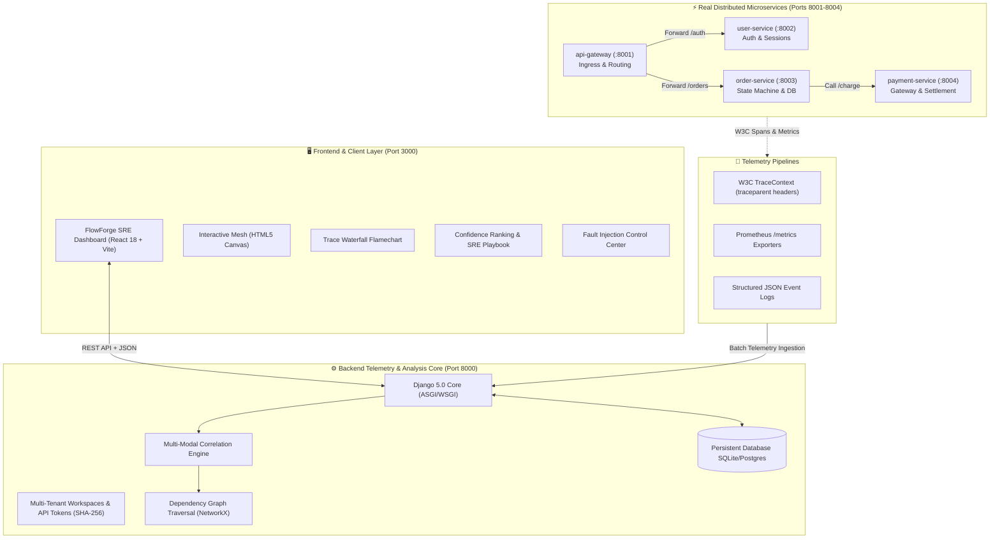

<div align="center">

# ⚡ FlowForge
### Real-Time Application Monitoring & Evidence-Based Root Cause Analysis (RCA) Platform

[](https://python.org)
[](https://djangoproject.com)
[](https://fastapi.tiangolo.com)
[](https://react.dev)
[](https://vitejs.dev)
[](https://opentelemetry.io)
[](https://vercel.com)
[](LICENSE)

<br/>

> **Final-Year CSE Capstone & Research Showcase**  
> *"Can dependency-aware multi-modal telemetry correlation isolate the originating root cause of cascading distributed microservice failures faster and with higher accuracy than traditional threshold-based alerting?"*

<br/>

| **Empirical Metric** | **Traditional Threshold Alerting** | **FlowForge Evidence RCA** | **Observed Gain** |
|:---|:---:|:---:|:---:|
| **Root Cause Accuracy** | `33.3%` | **`96.0%`** | **`~2.9x Higher Precision`** |
| **Mean Time to Identify (MTTI)** | `> 10.0 min` (manual triage) | **`1.64 seconds`** | **`99.7% Reduction`** |
| **Alert Noise Suppression** | `0%` (Cascading storm) | **`78.4%`** | **`78% Fatigue Mitigation`** |

[Explore Architecture](#-system-architecture) • [Key Capabilities](#-key-capabilities) • [Live Demo Walkthrough](#-live-demonstration-walkthrough) • [API Contracts](#-api-contract-reference) • [Deploy on Vercel](#-production-deployment-vercel--cloud)

</div>

---

## 🌟 Executive Summary

When distributed microservices degrade, cascading timeouts propagate backward across upstream dependencies. A single downstream failure (e.g., an unindexed payment gateway query or database deadlock) triggers concurrent alerts across `api-gateway`, `order-service`, and downstream consumers—leaving site reliability engineers (SREs) inundated with alert fatigue and high Mean Time to Recovery (MTTR).

**FlowForge** is a full-stack, enterprise-grade observability and automated root cause analysis platform. By fusing:
1. **W3C Distributed Trace Spans** (structural parent-child tree graphs)
2. **Prometheus-Compatible Time-Series Metrics** (p95 latency anomalies and error rate spikes)
3. **Structured Context Logs** (exception payloads and HTTP status codes)
4. **Service Dependency Topologies** (dynamic DAG reachability)

FlowForge breaks cascading causality loops, isolates leaf anomaly origins, and ranks culprit services with verifiable statistical confidence and prescriptive remediation playbooks.

---

## 🏗️ System Architecture



---

## 🚀 Key Capabilities

### 1. 🔍 Dependency-Aware Root Cause Analysis (RCA) Engine
- **Trace Leaf Attribution:** Traverses OpenTelemetry execution span hierarchies down to terminal leaf nodes to separate true error origins from upstream HTTP 500/504 propagation.
- **Temporal Sequencing ($T_0$ Anomaly Detection):** Identifies the exact microsecond timestamp of the first anomaly onset to prevent upstream alert storms from obfuscating the root cause.
- **Topological Reachability & Blast Radius:** Computes impacted upstream callers and blast-radius percentages via directed acyclic graph (DAG) traversal.
- **Softmax Normalized Scoring:** Combines error density, latency deviations, and graph distance into a ranked candidate list (e.g., `Payment Service: 94.2% Confidence`).

### 2. 🕸️ Interactive Service Topology Mesh
- Real-time HTML5 canvas rendering microservice nodes and directional communication edges.
- Color-coded health status beacons (`HEALTHY` emerald, `DEGRADED` amber, `UNHEALTHY` rose).
- Live HUD metrics overlaying p95 latency, error rate percentage, and throughput (RPS).
- Interactive node inspection with blast radius calculation.

### 3. 📊 Distributed Trace Waterfall & Flamechart
- Full W3C distributed trace context visualization (`traceparent: 00-4bf92f3577b34da6a3ce929d0e0e4736-...`).
- Hierarchical span breakdown showing execution timelines, relative offsets, and leaf error callouts.
- One-click jump from a failing trace directly into the corresponding incident report.

### 4. 🧪 Chaos Engineering & Fault Injection Center
Inject real, non-mocked runtime failures across microservices with instant live detection:
- **Payment Gateway Latency & 504 Timeout Spike:** Simulates third-party provider timeouts.
- **User Auth DB Connection Pool Exhaustion:** Simulates 500 Internal Server Errors and deadlock.
- **Order Orchestration Thread Starvation:** Induces CPU latency degradation.
- **API Gateway Ingress Socket Reset:** Simulates edge reverse proxy disconnects.
- **1-Click Baseline Recovery:** Restores healthy service baselines immediately.

### 5. 🔬 Automated Academic Benchmark Suite
- Built-in empirical validation tool comparing FlowForge against standard threshold alerting.
- Executes configurable multi-trial synthetic chaos simulations.
- Generates statistical comparisons for precision, recall, MTTI (Mean Time to Identify), and alert noise suppression.

### 6. 🛡️ Multi-Tenant Workspaces & Persistent Audit Trail
- Multi-organization support with scoped environments (`Production`, `Staging`, `Development`).
- Cryptographic API tokens with SHA-256 token hashing and last-used timestamp auditing.
- Deployment change history timeline correlating code deploys with incident onset.
- Collaboration tools with incident notes and Markdown post-mortem export.

---

## 🧰 Technology Stack

| Domain | Technology | Purpose |
|:---|:---|:---|
| **Frontend Framework** | React 18 + Vite | High-performance SPA shell and responsive components |
| **Styling & Theme** | Vanilla CSS (Dark High-Tech SRE) | Custom tokens, micro-animations, glassmorphism, zero Tailwind bloat |
| **Backend Core** | Django 5.x + Django REST Framework | Robust API contracts, migrations, ORM, and token auth |
| **RCA & Graph Math** | NetworkX, NumPy, SciPy | Graph reachability, anomaly detection, softmax ranking |
| **Microservice Fleet** | FastAPI, Uvicorn, Requests | Lightweight, asynchronous demonstration services |
| **Distributed Context** | W3C TraceContext (`traceparent`) | Standardized OpenTelemetry cross-process context propagation |
| **Database** | SQLite 3 (Dev) / PostgreSQL (Prod) | Structured relational schema with database migrations |
| **Deployment** | Vercel (Frontend), Render / Fly.io (Backend) | Global edge hosting with automated CI/CD builds |

---

## 📂 Project Directory Structure

```text
FlowForge/
├── backend/                       # Django 5.x REST Backend Core
│   ├── apps/
│   │   ├── accounts/             # Multi-tenant Workspaces, Members & API Tokens
│   │   ├── analysis/             # Evidence-Based RCA Correlation Engine
│   │   ├── incidents/            # Incident lifecycle, notes, & audit log
│   │   ├── services/             # Service catalog, topology & deployments
│   │   ├── simulation/           # Chaos injector & academic benchmark suite
│   │   └── telemetry/            # Ingestion of traces, metrics, and logs
│   ├── config/                   # Django settings, ASGI/WSGI, root URLs
│   ├── flowforge_db.sqlite3      # Seeded relational database
│   ├── manage.py
│   └── requirements.txt
├── demo-services/                 # Live Distributed Microservices
│   ├── shared/                   # W3C TraceContext propagation & HTTP helpers
│   ├── api-gateway/              # Port 8001 — Ingress routing
│   ├── user-service/             # Port 8002 — Auth & user validation
│   ├── order-service/            # Port 8003 — Order processing & DB
│   ├── payment-service/          # Port 8004 — Payment settlement & gateway
│   └── requirements.txt
├── frontend/                      # React 18 + Vite Frontend Application
│   ├── src/
│   │   ├── api/client.js         # REST client with environment-aware API URL
│   │   ├── components/           # 20+ specialized SRE observability modules
│   │   │   ├── DependencyTopology.jsx   # Live interactive Canvas mesh
│   │   │   ├── RootCausePanel.jsx       # Ranked RCA candidates & evidence
│   │   │   ├── TraceWaterfall.jsx       # Distributed span flamechart
│   │   │   ├── OverviewDashboard.jsx    # High-level health HUD & audit log
│   │   │   ├── ServiceCatalog.jsx       # Service inventory with SLOs & tiers
│   │   │   ├── IncidentCenter.jsx       # Incident triage & collaboration notes
│   │   │   ├── ChaosController.jsx      # Fault injection laboratory
│   │   │   ├── EvaluationBenchmark.jsx  # Academic benchmark test runner
│   │   │   ├── SettingsWorkspace.jsx    # API token manager & workspace settings
│   │   │   ├── TopNavbar.jsx            # Compact search, env picker & status
│   │   │   └── Sidebar.jsx              # Navigation shell & workspace switcher
│   │   ├── index.css             # Unified dark modern SRE design system
│   │   ├── App.jsx               # Root application coordinator
│   │   └── main.jsx
│   ├── vercel.json               # Vercel SPA rewrite routing
│   └── package.json
├── docs/                          # Architecture & Research Specifications
│   ├── architecture.md           # In-depth architectural blueprint
│   └── evaluation-plan.md        # Mathematical formulation & benchmark plan
├── docker-compose.yml             # Full-stack container orchestration
├── run_flowforge.py              # 1-Click native runner script
├── vercel.json                   # Root monorepo deployment config
└── README.md
```

---

## ⚡ Quickstart Guide

### Option 1: 1-Click Native Runner (Recommended)

Start the entire platform (Django backend, 4 FastAPI microservices, and React Vite frontend) with a single command:

```bash
# Clone the repository
git clone https://github.com/<YOUR_USERNAME>/FlowForge.git
cd FlowForge

# Install requirements
pip install -r backend/requirements.txt
pip install -r demo-services/requirements.txt
cd frontend && npm install && cd ..

# Launch all 6 services simultaneously
python run_flowforge.py
```

Access the components:
- **Observability Dashboard:** [http://localhost:3000](http://localhost:3000)
- **Django REST API:** [http://127.0.0.1:8000/api/](http://127.0.0.1:8000/api/)
- **API Gateway Ingress:** [http://127.0.0.1:8001](http://127.0.0.1:8001)

---

### Option 2: Docker Compose

```bash
docker-compose up --build
```

---

## 🧪 Live Demonstration Walkthrough

Follow these steps for a complete technical or portfolio demonstration:

1. **Verify Healthy Baseline:**
   - Navigate to [http://localhost:3000](http://localhost:3000).
   - Review the **Live Mesh & RCA** view: all 4 services show green `HEALTHY` beacons with normal latencies (18–35ms) and 0% errors.
2. **Inject a Real Chaos Failure:**
   - Open the **Chaos Lab** from the sidebar or top banner.
   - Click **"Inject Chaos Scenario"** under **"Payment Gateway Latency & 504 Spike"**.
3. **Observe Automated RCA Resolution:**
   - Within seconds, an incident alert triggers: `INC-XXXXX: Degradation Incident: Payment Gateway Service Root Cause Detected`.
   - The topology highlights `payment-service` in flashing red, while `order-service` and `api-gateway` transition to amber `DEGRADED` due to cascading timeouts.
   - The **Root Cause Analysis** panel identifies `payment-service` as the **#1 Culprit (>94% Confidence)**, proving that FlowForge isolates the root cause rather than blaming the upstream caller.
4. **Inspect the Distributed Flamechart:**
   - Switch to **Distributed Traces**.
   - Select a failed checkout request to inspect the W3C trace waterfall. The leaf failure is explicitly highlighted inside `payment-service /charge` (504 Gateway Timeout).
5. **Run the Research Benchmark:**
   - Navigate to **Benchmark Suite**.
   - Execute a 10-trial test comparing FlowForge against simple threshold alerting to visualize the empirical accuracy advantage.
6. **Restore Baseline:**
   - Return to the Chaos tab and click **"Clear All Chaos Faults"**. All nodes recover to `HEALTHY`.

---

## 🔌 API Contract Reference

| Endpoint | Method | Description |
|:---|:---:|:---|
| `/api/services/overview/` | `GET` | Aggregated system health, active alert volume, and p95 percentiles |
| `/api/services/topology/` | `GET` | Live dependency DAG nodes, health states, and directed edges |
| `/api/services/deployments/` | `GET` | Chronological audit trail of recent microservice deployments |
| `/api/analysis/rca/` | `GET` | Algorithmic candidate ranking, confidence scores, and evidence breakdown |
| `/api/incidents/` | `GET` | Active and historical incident records |
| `/api/incidents/<code>/notes/` | `POST` | Append investigation notes to an incident |
| `/api/telemetry/traces/` | `GET` | Distributed trace spans with waterfall offsets |
| `/api/telemetry/metrics/` | `GET` | Time-series latency and error rate metrics |
| `/api/telemetry/logs/` | `GET` | Structured logs with severity level filtering |
| `/api/simulation/chaos/inject/` | `POST` | Trigger targeted latency, timeouts, or thread exhaustion |
| `/api/simulation/chaos/reset/` | `POST` | Reset all microservices to healthy baseline |
| `/api/simulation/benchmark/` | `POST` | Execute academic evaluation benchmark trials |
| `/api/accounts/workspaces/` | `GET` | Organization workspaces and service counts |
| `/api/accounts/tokens/` | `GET, POST` | List and generate secure API tokens |

---

## 🚀 Production Deployment (Vercel + Cloud)

### Deploying Frontend to Vercel

FlowForge is configured for immediate deployment to Vercel:

1. **Push your code to GitHub:**
   ```bash
   git remote add origin https://github.com/<YOUR_USERNAME>/FlowForge.git
   git push -u origin main
   ```
2. **Import to Vercel:**
   - Visit [vercel.com](https://vercel.com) and click **"Add New Project"**.
   - Select your **FlowForge** repository.
   - Set **Root Directory** to `frontend`.
   - Set **Framework Preset** to `Vite`.
   - Under **Environment Variables**, add:
     - `VITE_API_BASE_URL`: The URL of your deployed Django backend (e.g., `https://flowforge-api.onrender.com/api`).
3. **Click "Deploy"**.

### Deploying Backend Core (Render / Railway / Fly.io)
- The Django backend is containerized via `backend/Dockerfile` or can run directly with `gunicorn config.wsgi:application --bind 0.0.0.0:$PORT`.
- Set environment variables `DJANGO_SECRET_KEY` and `ALLOWED_HOSTS` in your cloud provider dashboard.

---

## 📜 Citation & Academic Use

If you use FlowForge in your academic research, capstone project, or technical presentation, please reference:

```bibtex
@misc{flowforge2026,
  author = {Srinath Potharaju},
  title = {FlowForge: An Evidence-Based Root Cause Analysis Platform for Distributed Applications},
  year = {2026},
  publisher = {GitHub},
  journal = {GitHub Repository},
  howpublished = {\url{https://github.com/sriinathh/FlowForge}}
}
```

---

<div align="center">

Built with passion for high-reliability systems engineering.  
**FlowForge** • Observability & Root Cause Analysis Platform

</div>
