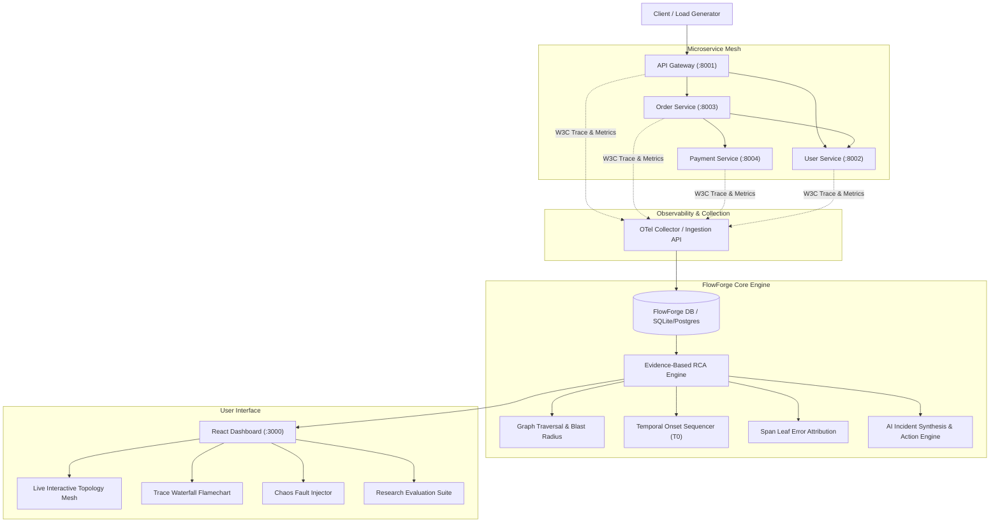

# FlowForge: System Architecture & Technical Specification

## 1. Executive Summary
**FlowForge** is an evidence-based Root Cause Analysis (RCA) platform for distributed microservice architectures. When complex distributed systems fail, cascading errors and high latency typically trigger an "alert storm", simultaneously sounding alarms on edge proxies, intermediate orchestrators, and downstream persistence tiers. 

Traditional threshold alerting treats symptoms as isolated incidents, forcing site reliability engineers (SREs) to manually inspect disparate logs, metrics, and trace waterfalls. **FlowForge** correlates multi-modal telemetry (OpenTelemetry distributed traces, Prometheus-compatible time-series metrics, structured logs, and service dependency topology graphs) to algorithmically pinpoint and rank the originating failure node with quantifiable confidence.

---

## 2. System Architecture Diagram

---

## 3. Core Subsystems

### 3.1 Demo Microservice Cluster
The platform provides 4 instrumented microservices modeling an e-commerce checkout flow:
1. **API Gateway (`:8001`)**: Edge ingress reverse proxy. Propagates W3C `traceparent` headers (`00-{trace_id}-{span_id}-01`).
2. **Order Service (`:8003`)**: Orchestrator service. Validates customer credentials via User Service and charges balance via Payment Service.
3. **User & Auth Service (`:8002`)**: Handles customer credentials, JWT token verification, and profile queries.
4. **Payment Gateway Service (`:8004`)**: Handles credit card charges and bank settlement.

Each service includes a `/chaos/inject` endpoint allowing controlled faults:
- `LATENCY_AND_TIMEOUT`: Injects 2800ms delay and 504 Gateway Timeout.
- `ERROR_500`: Injects database connection pool deadlock and internal server error.
- `RESOURCE_THROTTLE`: Injects queue saturation and thread starvation.
- `SOCKET_RESET`: Injects reverse proxy socket reset.

### 3.2 OpenTelemetry Distributed Tracing Pipeline
- Context propagation conforms to **W3C TraceContext** specifications.
- Spans record `trace_id`, `span_id`, `parent_span_id`, `start_time`, `end_time`, `duration_ms`, `has_error`, and HTTP status codes.
- Telemetry batch reporter dispatches traces, metric points, and error logs directly to FlowForge ingestion endpoints.

### 3.3 Evidence-Based Root Cause Analysis (RCA) Pipeline
The FlowForge engine executes a multi-criteria scoring algorithm across 4 orthogonal dimensions:

#### A. Trace Leaf Error Attribution ($E_{trace}$)
When a downstream service fails (e.g., Payment Service times out), intermediate callers (Order Service and API Gateway) also throw secondary errors (e.g. `500 Call to dependent service failed`). 
FlowForge traverses the directed span tree of all failed traces in the evaluation window. It searches for **leaf error spans**—spans where `has_error = True` but *none* of their children have an error.
$$E_{trace}(S) = \frac{\sum_{t \in T_{fail}} \mathbb{I}(\text{LeafErrorSpan}(t) \in S)}{|T_{fail}|}$$

#### B. Temporal Onset Priority ($T_{score}$)
Downstream failure precedes upstream cascading alarms. FlowForge detects the onset timestamp $T_{onset}(S)$ when service $S$ first breached SLA thresholds:
$$T_{score}(S) = \max\left(0.1, 1.0 - \frac{T_{onset}(S) - T_{min}}{T_{max} - T_{min} + \epsilon}\right)$$
The service that perturbed earliest receives a score close to 1.0.

#### C. Topological Blast Radius & Leaf Centrality ($D_{topo}$)
Using NetworkX directed graph analysis $G = (V, E)$, FlowForge computes reachability:
- Successors $\text{Desc}(S)$ (services $S$ calls)
- Ancestors $\text{Anc}(S)$ (services that call $S$)
Leaf dependencies (services with no further dependencies) that induce errors in multiple callers receive elevated leaf weighting.

#### D. Metric Severity Magnitude ($Z_{metric}$)
Combines error rate $\Delta E$ and latency z-score:
$$Z_{metric}(S) = \min\left(1.0, \frac{ErrorRate(S)}{100} \cdot 0.7 + \min\left(1.0, \frac{P95Latency(S)}{1500}\right) \cdot 0.3\right)$$

#### E. Fused Composite Ranking Score
$$Score(S) = w_{trace} E_{trace}(S) + w_{temp} T_{score}(S) + w_{topo} D_{topo}(S) + w_{metric} Z_{metric}(S)$$
*(Default weights: $w_{trace} = 0.35, w_{temp} = 0.30, w_{topo} = 0.20, w_{metric} = 0.15$)*

Scores are normalized across candidate services to produce an intuitive confidence percentage distribution $\sum P(S) = 100\%$.

---

## 4. REST API Endpoint Specifications

| Method | Endpoint | Description |
|---|---|---|
| `GET` | `/api/services/topology/` | Returns service nodes and edges with real-time metrics |
| `POST` | `/api/services/seed/` | Resets default service topology |
| `POST` | `/api/telemetry/ingest/` | Batch ingestion endpoint for spans, metrics, and logs |
| `GET` | `/api/telemetry/traces/` | Distributed traces feed with status and latency |
| `GET` | `/api/telemetry/traces/<id>/waterfall/` | Detailed span execution hierarchy with offsets |
| `GET` | `/api/incidents/list/` | Active and historical incident records |
| `POST` | `/api/incidents/<id>/resolve/` | Marks incident resolved and clears alarm state |
| `GET` | `/api/analysis/rca/` | Executes RCA pipeline and returns ranked root causes |
| `GET` | `/api/analysis/compare/` | Compares FlowForge RCA vs Naive Threshold Alerting |
| `POST` | `/api/simulation/inject/` | Injects selected chaos scenario into mesh |
| `POST` | `/api/simulation/benchmark/run/` | Runs statistical evaluation trials |
